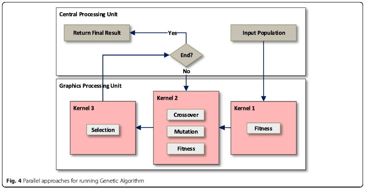

# Parallel genetic algorithm for the TSP

[](https://isocpp.org/)
[](#build)
[](https://doi.org/10.1186/s13677-020-0157-4)
[](LICENSE)
[](#reproducibility)

This repository implements the paper's parallel genetic algorithm (GA) for the Euclidean traveling salesman problem (TSP), the equivalent routing subproblem evaluated in the paper. The method has three stages: initial-population fitness; offspring generation, crossover, mutation, and child fitness; and tournament selection. The CPU backend uses TBB when available. An optional CUDA backend implements the same stages as three GPU kernels, with kernel launches in the default stream providing global stage boundaries without copying population data to the host between generations.

> **Scope.** The paper motivates applying TSP routing to vehicular cloud computing. This repository implements and measures the GA/TSP method; it does not simulate vehicles, cloud services, road constraints, or a full vehicle-routing problem with capacities and time windows.



Figure reproduced from Fig. 4 of Abbasi et al. (2020). See [Citing this work](#citing-this-work).

## Build

Requirements: CMake 3.16+ and a C++17 compiler. The CPU executable uses oneTBB when it is found; otherwise it builds the same CPU stages with `std::thread` as a portable fallback. The CUDA executable is included when CMake finds a CUDA compiler. To reproduce the paper's backends, install oneTBB and the NVIDIA CUDA Toolkit on a CUDA-capable system.

```sh
cmake -S . -B build -DCMAKE_BUILD_TYPE=Release
cmake --build build --config Release
```

## Run

Input is a TSPLIB-style coordinate file with a `NODE_COORD_SECTION` (the `EDGE_WEIGHT_TYPE` header is not used; distances are Euclidean). City indices written to the route CSV are 1-based, following the input row order.

```sh
./build/parallel-vrp data/sample.tsp \
  --population 1024 --generations 100 --offspring-percent 40 \
  --threads 4 --seed 1 --output results/sample-route.csv
```

When built with oneTBB, `parallel-vrp` uses TBB task scheduling and the requested `--threads` concurrency. On a CUDA build, run `./build/parallel-vrp-cuda` with the same arguments; its `--threads` value sets threads per block, with one logical CUDA thread assigned per chromosome in the population. CUDA kernel launches run in order on the default stream, which serves as the synchronization switch between kernels described in the paper. CUDA timing excludes the one-time host-to-device setup copy and includes kernel execution and launch overhead.

The program prints the input size, best closed-tour length, elapsed wall time, seed, and worker count. `--help` prints the command synopsis. The implementation fixes the operator probabilities to the paper's reported values: crossover 0.8, mutation 0.02, and selection probability 0.8.

## Reproducibility

Every random stream is derived from the supplied seed and stable generation, item, and stage identifiers. A run with the same executable, input, and parameters therefore uses the same random choices regardless of thread scheduling. Timing is hardware- and load-dependent. Record compiler, OS, CPU, population, generation count, offspring percentage, worker count, seed, and input checksum when comparing timing.

The supplied `scripts/benchmark.sh` runs a fixed parameter matrix and emits one CSV row per run. It repeats each configuration 10 times, matching the paper's repetition count. The executable is fixed at `./build/parallel-vrp`; for CUDA comparisons substitute `./build/parallel-vrp-cuda` as the script's first argument. The paper's measurements used TBB 2018 and CUDA 8 on an Intel i5-7600 / GTX 1060 and VLSI-derived BCL380, RBU737, and PBD984 datasets. Those datasets are not bundled here, so the sample instance supports a reproducible workflow but not a numerical replication of the published plots. Use the same input file and parameters for each backend comparison.

```sh
cmake -S . -B build -DCMAKE_BUILD_TYPE=Release && cmake --build build --config Release
scripts/benchmark.sh ./build/parallel-vrp data/sample.tsp results/benchmark.csv
```

## Method and implementation notes

1. A chromosome is a permutation of city indices; fitness is the Euclidean length of the closed tour, including the return edge.
2. The initial population is randomly shuffled, and its fitness is evaluated in parallel.
3. Each offspring independently samples a parent. With probability 0.8 the single-parent, single-point crossover is applied; with probability 0.02 a pair of genes is swapped.
4. Child fitness is calculated before selection. For each next-generation slot, two candidates are sampled from the combined parents-and-offspring pool. With probability 0.8 the shorter-tour candidate wins; otherwise the other candidate wins.
5. The next population is completed in parallel and the stages synchronize at their boundaries. The lowest-length chromosome after the requested generations is returned.

The paper's prose describes crossover as moving the suffix after a random point to form a child, but does not specify how that move is performed. Both backends use a cyclic suffix rotation, which preserves every city exactly once and is explicit/reproducible. Since a closed TSP tour is invariant to cyclic rotation, crossover alone does not change its length; the paper's swap mutation provides variation. The paper does not publish its source code or fully specify every selection detail, so the rotation and parent-plus-offspring tournament pool are explicit operational choices rather than a claim to recover the authors' exact source-level implementation. The CUDA backend transfers the initial population once, keeps generations resident on the GPU, and synchronizes stages through ordered kernel launches.

## Citing this work

If this implementation or its description informs your work, cite the method's paper:

```bibtex
@article{abbasi2020efficient,
  author  = {Abbasi, Mahdi and Rafiee, Milad and Khosravi, Mohammad R. and Jolfaei, Alireza and Menon, Varun G. and Koushyar, Javad Mokhtari},
  title   = {An efficient parallel genetic algorithm solution for vehicle routing problem in cloud implementation of the intelligent transportation systems},
  journal = {Journal of Cloud Computing},
  volume  = {9},
  number  = {6},
  year    = {2020},
  doi     = {10.1186/s13677-020-0157-4},
  url     = {https://doi.org/10.1186/s13677-020-0157-4}
}
```

Paper: [https://doi.org/10.1186/s13677-020-0157-4](https://doi.org/10.1186/s13677-020-0157-4). The paper is open access under [CC BY 4.0](https://creativecommons.org/licenses/by/4.0/); Fig. 4 is reproduced here with attribution. The implementation in this repository is licensed under MIT; see [LICENSE](LICENSE).

## License

Source code: MIT. The included paper figure remains attributed to its authors and is covered by the paper's CC BY 4.0 terms.
